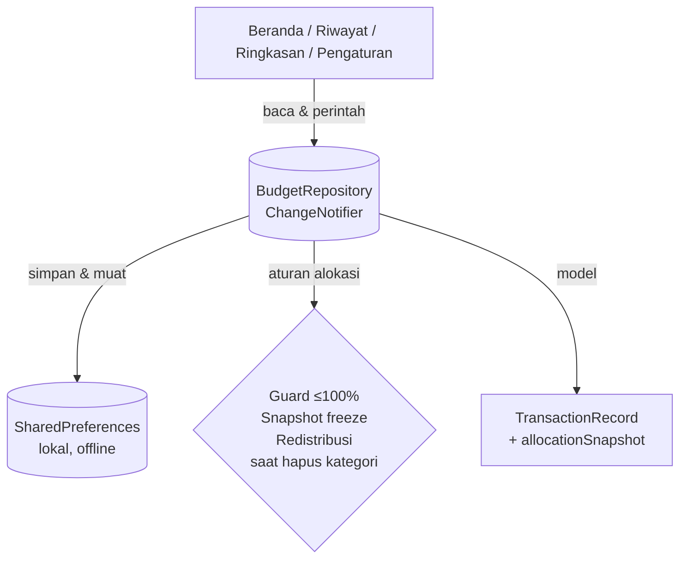
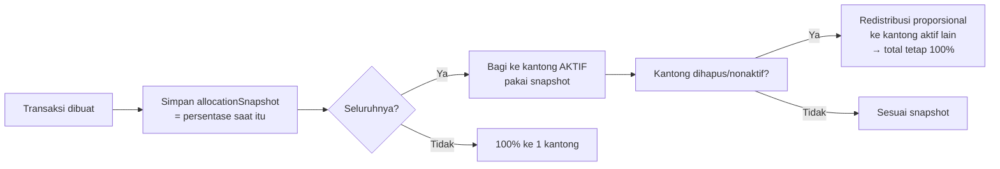
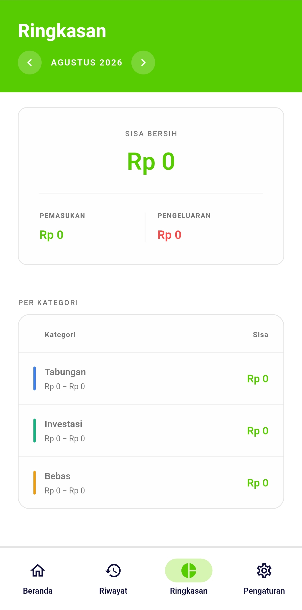
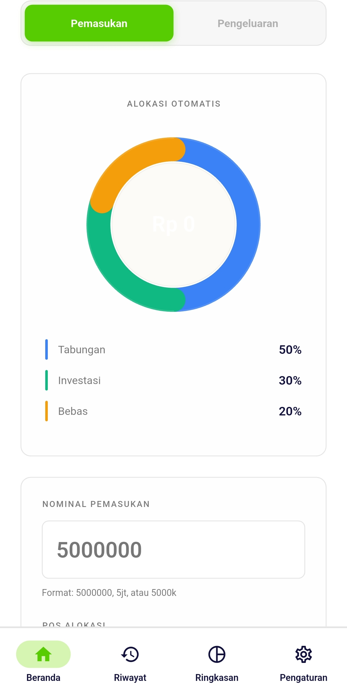

# Pundi

Aplikasi alokasi budget berbasis persentase yang **100% offline** (Flutter).
Catat pemasukan/pengeluaran, bagi otomatis ke "kantong" (kategori) sesuai
persentase — tanpa login dan tanpa cloud.

## Fitur
- **Alokasi % per kantong** — default: Tabungan 50% / Investasi 30% / Bebas 20%.
- **Guard ≤100%** — total alokasi aktif dicegah >100% (di UI **dan** repository).
- **Snapshot freeze** — persentase dikunci saat transaksi dibuat; ubah/edit
  kategori nanti **tidak** mengubah transaksi lama.
- **Nonaktifkan / Arsipkan** — dua tahap, keduanya bisa dibalik. Nonaktifkan
  disembunyikan tapi tetap tampil di "KATEGORI NONAKTIF"; Arsipkan memindahkannya
  ke "ARSIP" (barisnya tak pernah dihapus) dengan **reassign wajib** kalau ada
  transaksi (duit tak hilang, tak ada jatah "raib").
- **Metode pembayaran** — Tunai/QRIS/Transfer Bank/Debit/Kredit/E-Wallet, untuk
  pemasukan maupun pengeluaran, ikut ekspor-impor CSV.
- **Catatan pemasukan** — kolom remark yang sama dipakai pengeluaran, jadi
  pemasukan dan pengeluaran simetris di Riwayat, Ringkasan, dan CSV.
- **Ringkasan per bulan atau semua periode** — toggle PER BULAN / SEMUA;
  tabel per kategori ikut periode yang dipilih.
- **Import / Export CSV** (RFC 4180 via paket `csv`) — baris gagal dilaporkan,
  tak dibuang diam-diam.
- **4 tab**: Beranda · Riwayat · Ringkasan · Pengaturan. Tema ala Duolingo.

## Arsitektur

Satu sumber kebenaran: `BudgetRepository` (`ChangeNotifier`) di-inject lewat
Provider. Semua layar hanya baca/tulis lewat repo; repo yang menyimpan ke
SharedPreferences dan menjalankan semua aturan alokasi.



**Alur alokasi** (kunci behavior Pundi):



## Struktur Kode

```
lib/
  main.dart                      # entry point, tema, navigasi 4 tab
  repositories/
    budget_repository.dart      # STATE TUNGGAL + semua aturan alokasi
  models/
    transaction.dart            # TransactionRecord + allocationSnapshot
    period_summary.dart         # agregasi per bulan / semua periode
  screens/                      # home, history, summary, settings
  widgets/                      # edit_category_dialog, radial_allocation_viz, ...
  utils/                        # app_colors, app_info (lisensi), income_parser
test/                           # 53 test (guard, CSV, arsip, periode, lisensi)
```

## Build & Jalankan

```bash
flutter pub get
flutter run                 # debug di device / emulator
flutter build apk --release # butuh keystore (lihat Catatan)
flutter test               # jalankan test (analyzer harus clean)
```

## Catatan
- **Sepenuhnya offline.** Tidak ada Firebase/Google login; data di
  SharedPreferences (Reset Data = hapur lokal saja).
- **Release APK** butuh `android/local.properties` + `upload-keystore.jks`
  (keduanya gitignored, dipegang pemilik repo).
- **Crash log** ditulis ke `/sdcard/Download/pundi_crash.log` di device.

## Lisensi

MIT © xelisme — lihat [LICENSE](LICENSE). Metadata lisensi ada di
`lib/utils/app_info.dart`, satu sumber kebenaran untuk footer "Tentang" di
Pengaturan dan isi dialog lisensi; ada test yang menjaga keduanya tetap sama
dengan berkas LICENSE.

## Tangkapan Layar

| Beranda (alokasi otomatis) | Ringkasan (per kategori) |
|----------------------------|--------------------------|
|  |  |

> Catat pengeluaran: `docs/screenshots/beranda-pengeluaran.jpg`
